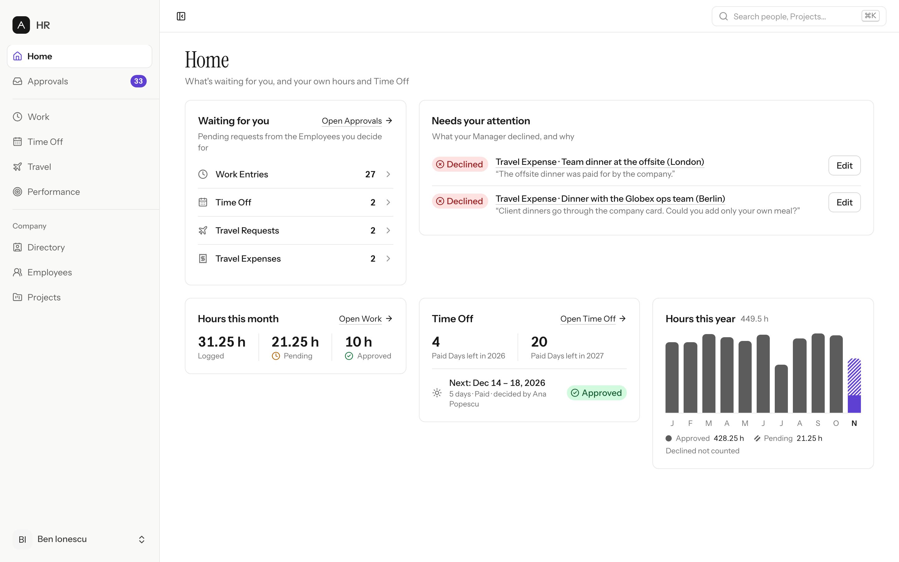
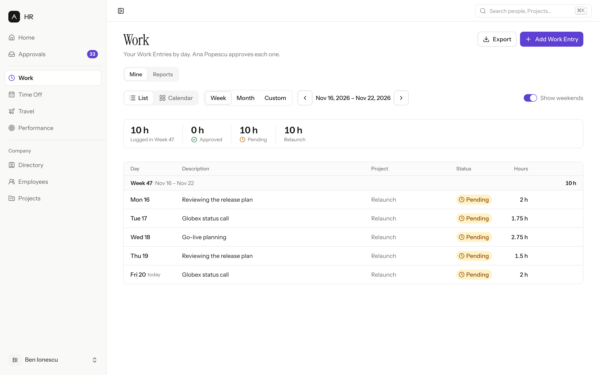
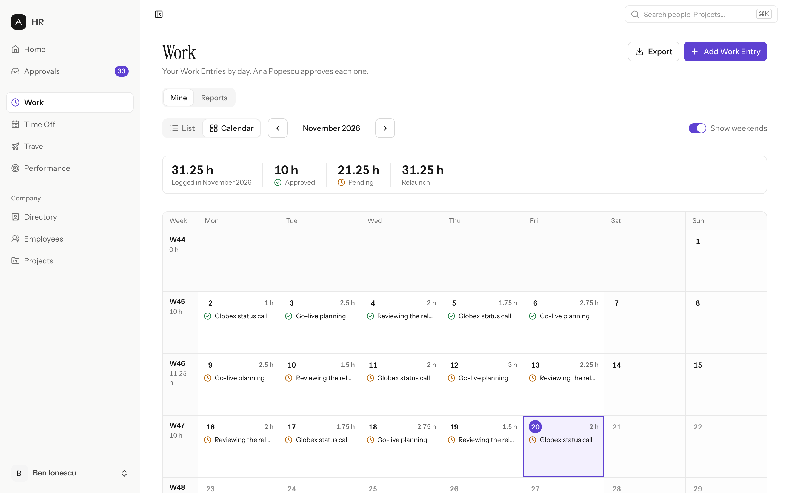
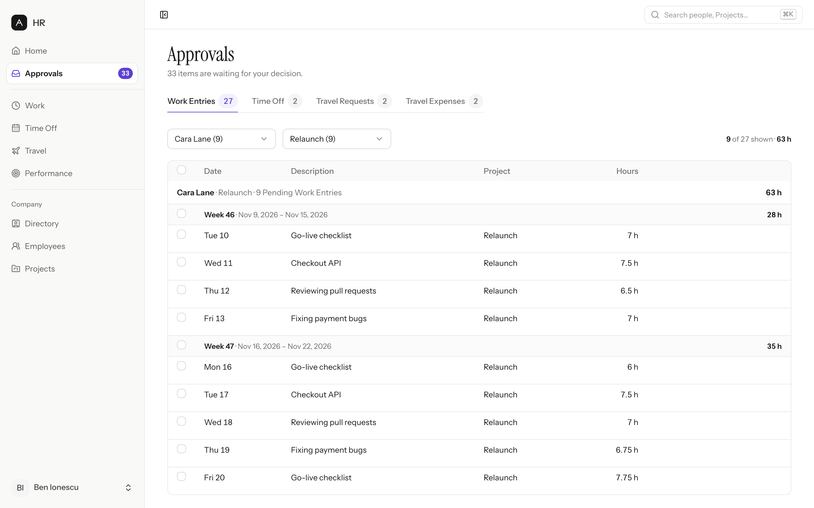
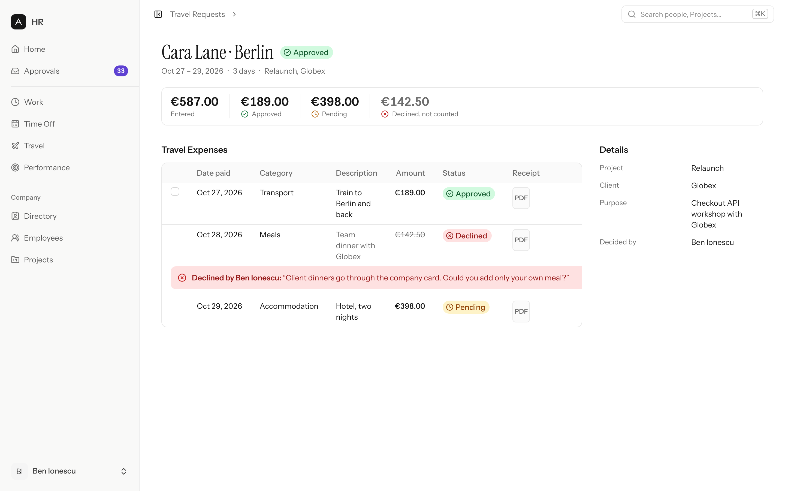
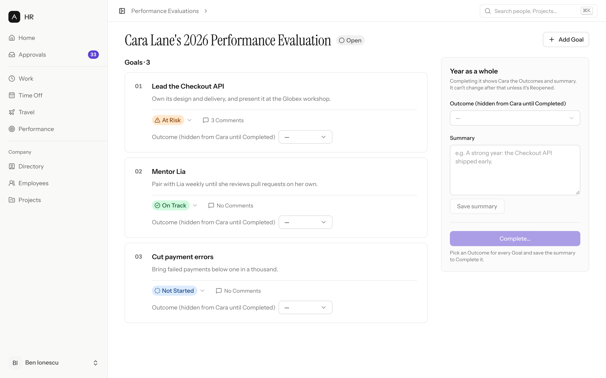
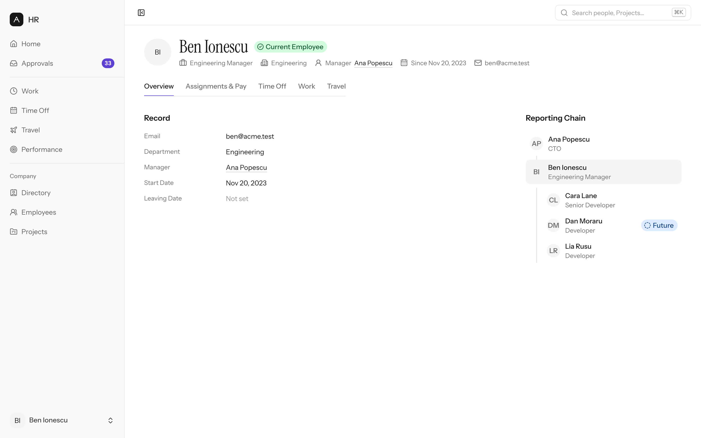

# HR

An HR system that a company runs for itself, one installation per company, to manage its own staff.

- **Employees**: Future, current and Former Employees, each with a Manager, a Department and a Reporting Chain.
- **Projects and Pay**: Clients, Projects and Assignments, with Pay attached to each Assignment.
- **Work Entries**: Employees log their time, and their Manager approves each Work Entry.
- **Time Off**: paid and unpaid requests, approved by the Manager and counted against each Employee's Paid Days.
- **Travel**: Travel Requests approved by the Manager, then Travel Expenses with receipts, each approved on its own and exported for pay-back.
- **Performance**: one Performance Evaluation per Employee per year, holding the Goals their Manager gives them, with Progress, Comments and an Outcome.
- **Access**: custom Roles and Permissions, with an Access Log.

Every Employee starts on **Home**, which shows what's waiting for them and their own hours and Time Off. Managers decide everything in one **Approvals** inbox. The **Directory** lists everyone, and the command menu (⌘K) finds people and Projects from any page.

The domain terms are defined in [`GLOSSARY.md`](GLOSSARY.md), and the design decisions are recorded in [`docs/adr/`](docs/adr). The UI follows the design system in [`docs/design-system/`](docs/design-system).

## Screenshots

**Home**: what's waiting for a Manager, what was declined and why, and their own hours and Time Off.



**Work**: an Employee's Work Entries, as a list for one week:



and as a calendar for one month:



**Approvals**: a Manager's Pending Work Entries, Time Off, Travel Requests and Travel Expenses in one place.



**Travel Request**: an Approved Travel Request with its Travel Expenses, each Pending, Approved or Declined on its own.



**Performance Evaluation**: a Manager's view of a Report's Goals for the year, with Progress, Comments and Outcomes.



**Employee page**: an Employee's record and Reporting Chain, with tabs for Assignments & Pay, Time Off, Work and Travel.



## Tech stack

- **Backend**: PHP 8.4, Laravel 13, Laravel Fortify (authentication), PostgreSQL
- **Frontend**: Inertia v3, Vue 3, TypeScript, Tailwind CSS 4, Reka UI, Laravel Wayfinder (typed routes)
- **Tooling**: Vite+, Pest 5 (including browser tests), Larastan, Pint

## Running locally

You need PHP 8.4, Composer, Node.js with npm, and PostgreSQL. [Laravel Herd](https://herd.laravel.com) provides all of these.

1. Clone the repository, then create a PostgreSQL database named `hr`. The database settings live in `.env`, which `.env.example` provides.

2. Install the dependencies, create `.env`, generate the app key, run the migrations and build the frontend:

    ```bash
    composer setup
    ```

3. Fill the database, choosing one of these:

    ```bash
    php artisan db:seed      # a demo company with sample data
    php artisan hr:install   # or an empty company, set up by prompts
    ```

    In the demo company, sign in as `ana@acme.test` (Admin) with the password `password`. The seeder prints the other demo accounts.

4. Start the app:

    ```bash
    composer dev
    ```

    This runs the web server, the queue worker, the log viewer and Vite together. If you use Herd, the site is served at `http://hr.test` instead, and `npm run dev` is enough.

## Tests

```bash
php artisan test     # the test suite
composer ci:check    # linting, type checks and tests, as CI runs them
```

## License

MIT. See [`LICENSE`](LICENSE).
